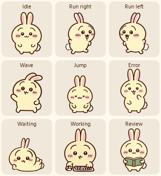

# Usagi for Codex

A fan-made animated desktop pet based on Usagi from *Chiikawa*. It includes nine Codex animation states, from idle and waving to working and reviewing.

## Install

1. Download this repository as a ZIP and extract it.
2. Copy the included `usagi` folder into `%USERPROFILE%\.codex\pets` on Windows, or `~/.codex/pets` on macOS.
3. In Codex Desktop, open **Settings → Pets**, select **Refresh**, then choose **Usagi**.

The `usagi` folder contains the manifest and transparent WebP sprite sheet. For more on selecting and showing pets, see the [Codex Pets guide](https://learn.chatgpt.com/docs/pets).

Usagi is a character from *Chiikawa* by Nagano. This is an unofficial fan project.
